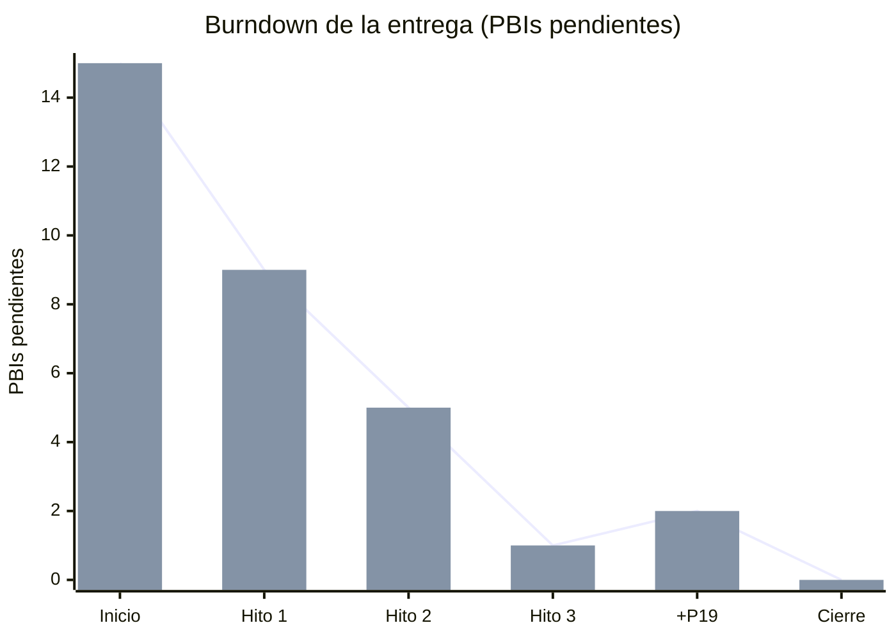

# Sprint 1

Del 29/09/2026 al 27/10/2026. La especificación define un sprint con cuatro hitos: la base de cualquier aplicación SaaS (usuarios, autenticación, persistencia, roles, seguridad y despliegue). El tablero está en [DoneTonic](https://app.donetonic.com) (espacio *TFG*, equipo *Colchoneros*): 19 PBIs (P1–P19) y 32 tareas (T1–T32), etiquetados *Hito 1* a *Hito 4*. **Estado: hecho.**

## Hito 1: Esqueleto y backend

**Objetivo de la especificación:** repositorio con GitHub Flow, CI y despliegue continuo desde el inicio, lógica de usuarios con pruebas unitarias y API.

**Qué se hizo:** estructura del repositorio, ramas protegidas, workflow de CI con GitHub Actions, despliegue continuo en Render, modelo y repositorio de usuarios en memoria, servicio de usuarios, pruebas con `node:test` y endpoints de la API (P1–P6, T1–T8).

**PR y etiqueta:** PRs #1–#8 y #10 hacia `hito-1/integracion`, cierre con #9 en `main` y etiqueta [`hito-1`](https://github.com/VelaElDios/la-grada-colchonera-saas/releases/tag/hito-1).

**Desviaciones del flujo:** ninguna.

## Hito 2: Autenticación y separación de capas

**Objetivo de la especificación:** separar la presentación de la comunicación con la API; registro, inicio y cierre de sesión, sesión entre recargas y rutas protegidas.

**Qué se hizo:** cliente de la API (`api.js`) separado de la interfaz (`ui.js` y `ui/`), registro e inicio de sesión con hash bcrypt, sesión que se mantiene al recargar, cierre de sesión en el servidor y middleware de autenticación (P7–P10, T9–T14).

**PR y etiqueta:** PRs #11–#16 hacia `hito-2/integracion`, cierre con #17 y etiqueta [`hito-2`](https://github.com/VelaElDios/la-grada-colchonera-saas/releases/tag/hito-2).

**Desviaciones del flujo:** ninguna.

## Hito 3: Persistencia, seguridad y administración

**Objetivo de la especificación:** base de datos real, secretos fuera del código, roles con un primer administrador y registro de actividad.

**Qué se hizo:** PostgreSQL (Neon) con migraciones y repositorio que sustituye al de memoria, sesiones en la base de datos, secretos en variables de entorno, roles usuario/administrador, panel de administración, baja de la propia cuenta y logs estructurados en JSON (P11–P14, T15–T20).

**PR y etiqueta:** PRs #18–#23 hacia `hito-3/integracion`, cierre con #24 y etiqueta [`hito-3`](https://github.com/VelaElDios/la-grada-colchonera-saas/releases/tag/hito-3).

**Desviaciones del flujo:** ninguna.

## Hito 4: Servicios externos y cierre

**Objetivo de la especificación:** inicio de sesión con un proveedor externo, confirmación de la cuenta por correo, manejo de errores, README completo y revisión final.

**Qué se hizo:** OAuth 2.0 con Google, confirmación por correo con enlace firmado y reenvío, manejo de errores de principio a fin, política de privacidad, README completo, revisión frente al enunciado, Docker y despliegue continuo en Google Cloud Run (P15–P19, T21–T32).

**PR y etiqueta:** cierre del sprint con #25–#33 (README, revisión, Docker, Cloud Run, memoria y capturas) y etiqueta [`sprint-1`](https://github.com/VelaElDios/la-grada-colchonera-saas/releases/tag/sprint-1). P15–P17 se integraron después en `main` con los PRs #37–#41 (23/10/2026) y la etiqueta [`hito-4`](https://github.com/VelaElDios/la-grada-colchonera-saas/releases/tag/hito-4) / `sprint-1-final`.

**Desviaciones del flujo:**

- La primera entrega (12/10/2026) se limitó a los Hitos 1–3, P18 y P19; el Hito 4 se completó el 23/10/2026.
- Las ramas del Hito 4 se desarrollaron en cadena y se integraron directamente en `main` (sin rama `hito-4/integracion`), reubicadas con *rebase* sobre el `main` real y con el CI en verde.
- Cambio de alcance: el PBI **P19** (Cloud Run) se añadió a mitad del sprint por los créditos de Google Cloud ([D-16](decisiones.md)).
- La prueba técnica (variante 3) se hizo sobre este repositorio con los PRs #34 y #35 (15/10/2026).

## Backlog y estado del Sprint 1

| PBI | Hito | Título | Estado | Entrega |
|---|---|---|---|---|
| P1 | H1 | Repositorio GitHub y flujo GitHub Flow | Hecho | [hito-1](https://github.com/VelaElDios/la-grada-colchonera-saas/releases/tag/hito-1) |
| P2 | H1 | Integración continua (CI) | Hecho | [hito-1](https://github.com/VelaElDios/la-grada-colchonera-saas/releases/tag/hito-1) |
| P3 | H1 | Despliegue continuo en URL pública | Hecho | [hito-1](https://github.com/VelaElDios/la-grada-colchonera-saas/releases/tag/hito-1) |
| P4 | H1 | Lógica de gestión de usuarios (en memoria) | Hecho | [hito-1](https://github.com/VelaElDios/la-grada-colchonera-saas/releases/tag/hito-1) |
| P5 | H1 | Pruebas unitarias automatizadas de la lógica | Hecho | [hito-1](https://github.com/VelaElDios/la-grada-colchonera-saas/releases/tag/hito-1) |
| P6 | H1 | Capa API de usuarios | Hecho | [hito-1](https://github.com/VelaElDios/la-grada-colchonera-saas/releases/tag/hito-1) |
| P7 | H2 | Frontend: interfaz y cliente de comunicación separados | Hecho | [hito-2](https://github.com/VelaElDios/la-grada-colchonera-saas/releases/tag/hito-2) |
| P8 | H2 | Registro e inicio de sesión locales | Hecho | [hito-2](https://github.com/VelaElDios/la-grada-colchonera-saas/releases/tag/hito-2) |
| P9 | H2 | Cierre de sesión y mantenimiento de la sesión | Hecho | [hito-2](https://github.com/VelaElDios/la-grada-colchonera-saas/releases/tag/hito-2) |
| P10 | H2 | Rutas protegidas en el servidor | Hecho | [hito-2](https://github.com/VelaElDios/la-grada-colchonera-saas/releases/tag/hito-2) |
| P11 | H3 | Persistencia en base de datos real | Hecho | [hito-3](https://github.com/VelaElDios/la-grada-colchonera-saas/releases/tag/hito-3) |
| P12 | H3 | Gestión de secretos con variables de entorno | Hecho | [hito-3](https://github.com/VelaElDios/la-grada-colchonera-saas/releases/tag/hito-3) |
| P13 | H3 | Roles de usuario y administrador | Hecho | [hito-3](https://github.com/VelaElDios/la-grada-colchonera-saas/releases/tag/hito-3) |
| P14 | H3 | Registro (log) de la actividad | Hecho | [hito-3](https://github.com/VelaElDios/la-grada-colchonera-saas/releases/tag/hito-3) |
| P15 | H4 | Inicio de sesión con proveedor externo (OAuth) | Hecho | [hito-4](https://github.com/VelaElDios/la-grada-colchonera-saas/releases/tag/hito-4) · PR #40 |
| P16 | H4 | Confirmación de cuenta por correo electrónico | Hecho | [hito-4](https://github.com/VelaElDios/la-grada-colchonera-saas/releases/tag/hito-4) · PRs #38 y #39 |
| P17 | H4 | Manejo de errores y feedback al usuario | Hecho | [hito-4](https://github.com/VelaElDios/la-grada-colchonera-saas/releases/tag/hito-4) · PRs #37–#41 |
| P18 | H4 | README completo y revisión de la entrega | Hecho | Cierre del sprint |
| P19 | H4 | Despliegue continuo en Google Cloud Run | Hecho | Cierre del sprint |

> Aunque P17 (manejo de errores) es del Hito 4, la aplicación ya tenía parte de esa funcionalidad desde el Hito 1: un manejador de errores común con el formato `{"error": {"code", "message"}}` y mensajes de error y de éxito en la interfaz.

## Trazabilidad del Sprint 1: tarea → rama → pull request

| PBI | Tarea | Descripción | Rama | Pull request | Estado |
|---|---|---|---|---|---|
| P1 | T1 | Crear repositorio y estructura base | `hito-1/T1-estructura-base` | [#1](https://github.com/VelaElDios/la-grada-colchonera-saas/pull/1) | Hecho |
|  | T2 | Configurar GitHub Flow | `hito-1/T2-github-flow` | [#2](https://github.com/VelaElDios/la-grada-colchonera-saas/pull/2) | Hecho |
| P2 | T3 | Workflow de CI con GitHub Actions | `hito-1/T3-integracion-continua` | [#3](https://github.com/VelaElDios/la-grada-colchonera-saas/pull/3) | Hecho |
| P3 | T4 | Despliegue automático en proveedor cloud gratuito | `hito-1/T4-despliegue-continuo · hito-1/T4-url-publica` | [#4](https://github.com/VelaElDios/la-grada-colchonera-saas/pull/4) · [#10](https://github.com/VelaElDios/la-grada-colchonera-saas/pull/10) | Hecho |
| P4 | T5 | Modelo de usuario y repositorio en memoria | `hito-1/T5-modelo-repositorio-memoria` | [#5](https://github.com/VelaElDios/la-grada-colchonera-saas/pull/5) | Hecho |
|  | T6 | Servicio de gestión de usuarios | `hito-1/T6-servicio-usuarios` | [#6](https://github.com/VelaElDios/la-grada-colchonera-saas/pull/6) | Hecho |
| P5 | T7 | Framework de pruebas y al menos 5 pruebas | `hito-1/T7-pruebas-unitarias` | [#7](https://github.com/VelaElDios/la-grada-colchonera-saas/pull/7) | Hecho |
| P6 | T8 | Endpoints de la API de usuarios | `hito-1/T8-api-usuarios` | [#8](https://github.com/VelaElDios/la-grada-colchonera-saas/pull/8) | Hecho |
| P7 | T9 | Cliente de comunicación con la API | `hito-2/T9-cliente-api` | [#11](https://github.com/VelaElDios/la-grada-colchonera-saas/pull/11) | Hecho |
|  | T10 | Interfaz de usuario: vistas y navegación | `hito-2/T10-vistas-navegacion` | [#12](https://github.com/VelaElDios/la-grada-colchonera-saas/pull/12) | Hecho |
| P8 | T11 | Registro y login en el backend (con hash) | `hito-2/T11-registro-login-backend` | [#13](https://github.com/VelaElDios/la-grada-colchonera-saas/pull/13) | Hecho |
|  | T12 | Formularios de registro y login en el frontend | `hito-2/T12-formularios-frontend` | [#14](https://github.com/VelaElDios/la-grada-colchonera-saas/pull/14) | Hecho |
| P9 | T13 | Mantener la sesión al recargar y cerrar sesión | `hito-2/T13-gestion-sesion` | [#15](https://github.com/VelaElDios/la-grada-colchonera-saas/pull/15) | Hecho |
| P10 | T14 | Middleware de autenticación y protección de rutas | `hito-2/T14-rutas-protegidas` | [#16](https://github.com/VelaElDios/la-grada-colchonera-saas/pull/16) | Hecho |
| P11 | T15 | Elegir y configurar la base de datos | `hito-3/T15-configurar-bd` | [#18](https://github.com/VelaElDios/la-grada-colchonera-saas/pull/18) | Hecho |
|  | T16 | Repositorio de BD sustituyendo al de memoria | `hito-3/T16-repositorio-postgres` | [#19](https://github.com/VelaElDios/la-grada-colchonera-saas/pull/19) | Hecho |
| P12 | T17 | Sacar los secretos a variables de entorno | `hito-3/T17-secretos-entorno` | [#20](https://github.com/VelaElDios/la-grada-colchonera-saas/pull/20) | Hecho |
| P13 | T18 | Roles, autorización y primer administrador (backend) | `hito-3/T18-roles-autorizacion` | [#21](https://github.com/VelaElDios/la-grada-colchonera-saas/pull/21) | Hecho |
|  | T19 | Panel de administración y baja de cuenta (frontend) | `hito-3/T19-panel-admin` | [#22](https://github.com/VelaElDios/la-grada-colchonera-saas/pull/22) | Hecho |
| P14 | T20 | Configurar el logging de la actividad relevante | `hito-3/T20-logging` | [#23](https://github.com/VelaElDios/la-grada-colchonera-saas/pull/23) | Hecho |
| P15 | T21 | Registrar la aplicación OAuth en Google | `hito-4/T22-google-oauth` (y configuración en Google Cloud, ver [procesos.md](procesos.md#configuración-de-los-servicios-externos-google-y-correo)) | [#40](https://github.com/VelaElDios/la-grada-colchonera-saas/pull/40) | Hecho |
|  | T22 | Flujo de inicio de sesión con OAuth | `hito-4/T22-google-oauth` | [#40](https://github.com/VelaElDios/la-grada-colchonera-saas/pull/40) | Hecho |
| P16 | T23 | Servicio de correo | `hito-4/T23-correo` | [#38](https://github.com/VelaElDios/la-grada-colchonera-saas/pull/38) | Hecho |
|  | T24 | Flujo de confirmación de la cuenta | `hito-4/T24-confirmacion` | [#39](https://github.com/VelaElDios/la-grada-colchonera-saas/pull/39) | Hecho |
| P17 | T25 | Errores en el backend | `hito-4/T25-secretos-hito4` y el resto de ramas del hito | [#37](https://github.com/VelaElDios/la-grada-colchonera-saas/pull/37)–[#41](https://github.com/VelaElDios/la-grada-colchonera-saas/pull/41) | Hecho |
|  | T26 | Mensajes de error en el frontend | `hito-4/T26-privacidad` y el resto de ramas del hito | [#37](https://github.com/VelaElDios/la-grada-colchonera-saas/pull/37)–[#41](https://github.com/VelaElDios/la-grada-colchonera-saas/pull/41) | Hecho |
| P18 | T27 | Completar el README | `hito-4/T27-readme-completo` | [#25](https://github.com/VelaElDios/la-grada-colchonera-saas/pull/25) | Hecho |
|  | T28 | Etiquetas de hito y revisión final | `hito-4/T28-revision-entrega` | [#26](https://github.com/VelaElDios/la-grada-colchonera-saas/pull/26) | Hecho |
|  | T31 | Revisión frase a frase contra el enunciado y README final | `hito-4/T31-revision-enunciado` | [#30](https://github.com/VelaElDios/la-grada-colchonera-saas/pull/30) | Hecho |
|  | T32 | Carpeta de la memoria en LuaLaTeX | `hito-4/T32-carpeta-memoria` | [#31](https://github.com/VelaElDios/la-grada-colchonera-saas/pull/31) | Hecho |
| P19 | T29 | Contenerizar la aplicación con Docker | `hito-4/T29-docker` | [#27](https://github.com/VelaElDios/la-grada-colchonera-saas/pull/27) | Hecho |
|  | T30 | Despliegue continuo en Cloud Run con GitHub Actions | `hito-4/T30-cloud-run` | [#28](https://github.com/VelaElDios/la-grada-colchonera-saas/pull/28) | Hecho |

Cierres de hito: [#9](https://github.com/VelaElDios/la-grada-colchonera-saas/pull/9) (Hito 1 → `main`), [#17](https://github.com/VelaElDios/la-grada-colchonera-saas/pull/17) (Hito 2 → `main`), [#24](https://github.com/VelaElDios/la-grada-colchonera-saas/pull/24) (Hito 3 → `main`) [#29](https://github.com/VelaElDios/la-grada-colchonera-saas/pull/29) (cierre del sprint → `main`) y [#32](https://github.com/VelaElDios/la-grada-colchonera-saas/pull/32) (revisión final y memoria → `main`).

> **Hito 4.** En DoneTonic las tareas del Hito 4 se llaman por lo que hacen (T21 *Registrar app OAuth*, T22 *Flujo login OAuth*, T23 *Servicio correo*, T24 *Flujo confirmación*, T25 *Errores backend* y T26 *Mensajes frontend*). En el repositorio el trabajo se repartió en cinco ramas (`hito-4/T22-google-oauth` #40, `T23-correo` #38, `T24-confirmacion` #39, `T25-secretos-hito4` #37 y `T26-privacidad` #41). El manejo de errores (P17) está repartido por las cinco. Las seis tareas se marcaron como hechas en DoneTonic al cerrar el Sprint 1.

## Evolución del Sprint 1

PBIs pendientes del alcance de la entrega (P1–P14, P18 y P19; 16 en total) según se cerraba cada hito. Es lo que muestran las gráficas *Backlog Burndown* y *Sprint Burndown* de DoneTonic:

| Momento | PBIs hechos | PBIs pendientes |
|---|---|---|
| Inicio del Sprint 1 (29/09/2026) | 0 | 15 |
| Cierre del Hito 1 (release `hito-1`) | 6 | 9 |
| Cierre del Hito 2 (release `hito-2`) | 10 | 5 |
| Cierre del Hito 3 (release `hito-3`) | 14 | 1 |
| Se añade P19 (Cloud Run) para usar los créditos de Google Cloud | 14 | 2 |
| Cierre del sprint (P18 y P19) | 16 | 0 |

> **Cambio de alcance durante el sprint:** el profesor repartió créditos de Google Cloud para educación. Para aprovecharlos se añadió al sprint el PBI **P19** (despliegue en Google Cloud Run), con sus tareas T29 y T30. Render se mantiene como despliegue alternativo.

## Capturas de DoneTonic

Tomadas el 29/10/2026, con el sprint cerrado.

**Tablero del Sprint 1** al 100 %: los 19 PBIs (P1–P19, etiquetas *Hito 1* a *Hito 4*) en verde, hechos.

**Sprint Burndown y Sprint Burnup del Sprint 1.** Los 19 PBIs completados. El escalón del burnup es el cambio de alcance (se añadió P19, Cloud Run) y el último tramo son los tres PBIs del Hito 4 (P15–P17).

## Revisión de la entrega frente al enunciado

Comprobación, frase a frase, de la especificación del proyecto (*Procesos de Ingeniería del Software, curso 2026-2027*). Cada fila indica cómo se cumple el requisito y dónde está la prueba.

| | |
|---|---|
| **Repositorio** | https://github.com/VelaElDios/la-grada-colchonera-saas |
| **Aplicación desplegada** | https://la-grada-colchonera-1081564062572.europe-southwest1.run.app (Google Cloud Run) |
| **Alcance** | Hitos 1, 2, 3 y 4. La primera entrega se limitó a los tres primeros; el Hito 4 se ha completado en la segunda |
| **Estado** | Todos los requisitos de los Hitos 1–4 están cumplidos, integrados en `main`, desplegados y comprobados en producción |

**Leyenda:** ✅ cumplido

### Cómo comprobarlo en cinco minutos

1. Abrir https://la-grada-colchonera-1081564062572.europe-southwest1.run.app. Si la aplicación estaba parada, la primera carga tarda unos segundos. El inicio muestra *Estado del servidor: en marcha*.
2. **Registrarse** con cualquier email y una contraseña de 8 caracteres o más. Una contraseña corta o un email repetido se rechazan con un mensaje claro.
3. **Entrar** con esa cuenta y **recargar la página**: la sesión se mantiene.
4. Ir a `#/admin`: un usuario normal vuelve a *Mi cuenta*. La API responde `403` en `/api/users`.
5. **Salir** y abrir `/api/users` directamente: responde `401`.
6. Desde *Mi cuenta*, **eliminar la cuenta**: ya no se puede volver a entrar con ella.
7. **Entrar como administrador** con las credenciales enviadas con la entrega: aparece *Administración* con el listado de usuarios (email, rol y estado). Ver [README › Acceso como administrador](../README.md#acceso-como-administrador-para-la-revisión).

### Arquitectura obligatoria

| Requisito | | Cómo se cumple | Evidencia |
|---|---|---|---|
| El backend sirve el frontend (mismo origen) | ✅ | Express sirve `public/` con `express.static` en el mismo servidor que la API | [`src/app.js`](../src/app.js), [`tests/frontend.test.js`](../tests/frontend.test.js) |
| El cliente no accede a la base de datos ni ejecuta lógica de negocio | ✅ | El navegador solo habla con `/api`. Las reglas (permisos, último administrador, hash…) están en `src/services` | [README › Arquitectura](../README.md#arquitectura) |
| Comunicación cliente-servidor solo a través de una API | ✅ | API REST JSON bajo `/api` | [README › API](../README.md#api) |
| Backend: capas API, lógica y datos en módulos separados | ✅ | `src/api/` → `src/services/` → `src/repositories/`. La lógica recibe el repositorio por parámetro, así que no sabe si los datos están en memoria o en PostgreSQL | [`src/api/`](../src/api), [`src/services/`](../src/services), [`src/repositories/`](../src/repositories) |
| Frontend: presentación y cliente de comunicación separados | ✅ | `public/js/ui.js` solo pinta vistas; todas las peticiones pasan por `public/js/api.js` | [`ui.js`](../public/js/ui.js), [`api.js`](../public/js/api.js) |

**Dónde está la frontera entre capas:**

- `src/api/users.js` llama a `userService.*` (API → lógica).
- `src/services/userService.js` llama a `userRepository.*` (lógica → datos).
- `src/app.js` es el único sitio donde se conectan las tres.
- En el navegador, `ui.js` llama a `api.*` (presentación → cliente).

### Gestión de usuarios

| Requisito | | Cómo se cumple | Evidencia |
|---|---|---|---|
| Registro de usuario local | ✅ | `POST /api/auth/register` valida el email y la contraseña (mínimo 8) y rechaza los emails repetidos (`409`) | [`src/api/auth.js`](../src/api/auth.js), captura 02 |
| … con confirmación por correo (la cuenta queda pendiente) | ✅ | Al registrarse la cuenta queda `pending` y se envía un correo con un enlace firmado (HMAC, 24 h). `GET /api/auth/confirm` la activa; una cuenta pendiente no puede entrar (`403 ACCOUNT_PENDING`) y puede pedir otro correo. `REQUIRE_EMAIL_CONFIRMATION` está activo por defecto | [`src/services/accountConfirmationService.js`](../src/services/accountConfirmationService.js), [`src/integrations/mailer.js`](../src/integrations/mailer.js), [`tests/accountConfirmation.test.js`](../tests/accountConfirmation.test.js) |
| Inicio de sesión local (email + contraseña) | ✅ | `POST /api/auth/login`. El mensaje es el mismo si el email no existe o si la contraseña es incorrecta, para no revelar qué cuentas existen | [`src/services/userService.js`](../src/services/userService.js), captura 03 |
| Inicio de sesión con un proveedor externo (OAuth) | ✅ | Google OAuth 2.0 (código de autorización) con `state` anti-CSRF; el intercambio del código se hace en el servidor y la cuenta se crea con `authProvider: google`. La app de Google está publicada, con su política de privacidad | [`src/integrations/googleOAuth.js`](../src/integrations/googleOAuth.js), [`tests/googleOAuth.test.js`](../tests/googleOAuth.test.js), [`public/privacidad.html`](../public/privacidad.html) |
| Cierre de sesión invalidando la sesión | ✅ | `POST /api/auth/logout` destruye la sesión **en el servidor** (en la tabla `session`) y borra la cookie; la cookie antigua deja de valer | [`tests/api.auth.test.js`](../tests/api.auth.test.js) |
| La sesión se mantiene entre recargas | ✅ | Cookie `httpOnly` con la sesión guardada en PostgreSQL. Al cargar, la interfaz llama a `GET /api/auth/me` | [`src/app.js`](../src/app.js), [`public/js/ui.js`](../public/js/ui.js) (`iniciar`) |

### Roles y consultas sobre usuarios

| Requisito | | Cómo se cumple | Evidencia |
|---|---|---|---|
| Dos roles como mínimo: usuario y administrador | ✅ | `ROLES = { user, admin }` | [`src/models/user.js`](../src/models/user.js) |
| Listar usuarios (solo admin), con email, rol y estado | ✅ | `GET /api/users` con `requireRole('admin')`. El panel *Administración* muestra email, rol, estado y fecha de alta | [`src/api/users.js`](../src/api/users.js), captura 07 |
| Comprobar si un usuario está activo (solo admin) | ✅ | `GET /api/users/:id/active` con `requireRole('admin')`. Un usuario normal recibe `403`, también si pregunta por su propia cuenta | [`tests/api.users.test.js`](../tests/api.users.test.js) |
| «Activo» = cuenta confirmada (u OAuth) y no eliminada; no es «conectado» | ✅ | `isUserActive` devuelve `status === 'active'`; las cuentas pendientes y eliminadas no están activas | [`src/services/userService.js`](../src/services/userService.js) |
| El admin elimina a cualquiera; un usuario solo su propia cuenta | ✅ | La API comprueba el permiso (`requireSelfOrRole`) y la lógica vuelve a comprobarlo (`deleteUser`). Además, nunca se elimina al último administrador | [`tests/userService.test.js`](../tests/userService.test.js) |
| Un usuario eliminado no puede volver a iniciar sesión | ✅ | Baja lógica (`status = 'deleted'`): el login se rechaza y una sesión abierta deja de valer en la siguiente petición | [`src/api/currentUser.js`](../src/api/currentUser.js), [`tests/api.users.test.js`](../tests/api.users.test.js) |
| Las restricciones se aplican en el servidor | ✅ | `requireAuth` (`401`), `requireRole` y `requireSelfOrRole` (`403`). La interfaz solo oculta los enlaces | [`src/api/currentUser.js`](../src/api/currentUser.js), captura 06 |
| Cómo se crea el primer administrador (justificado) | ✅ | Con las variables `ADMIN_EMAIL` y `ADMIN_PASSWORD` al arrancar (`ensureAdmin`): no hay contraseñas en el código y no hace falta tocar la base de datos a mano | [README › Roles](../README.md#roles), [`src/bootstrap.js`](../src/bootstrap.js) |

### Requisitos no funcionales y seguridad

| Requisito | | Cómo se cumple | Evidencia |
|---|---|---|---|
| Persistencia real: los datos sobreviven a un reinicio | ✅ | PostgreSQL en Neon con migraciones versionadas; las sesiones también se guardan en la base de datos | [`src/db/`](../src/db), [`tests/api.database.test.js`](../tests/api.database.test.js) |
| Ningún secreto en el código ni en el repositorio | ✅ | Solo variables de entorno: Secret Manager en Cloud Run y `.env` (ignorado por git) en local. En producción la aplicación no arranca si falta un secreto | [`src/loadConfig.js`](../src/loadConfig.js), [`tests/config.test.js`](../tests/config.test.js) |
| Archivo de ejemplo con los nombres de las variables, sin valores | ✅ | `.env.example` | [`.env.example`](../.env.example) |
| Contraseñas con una función de hash segura | ✅ | bcrypt (`bcryptjs`, coste 10). La API nunca devuelve el hash y el registro de actividad lo oculta | [`src/services/passwordHasher.js`](../src/services/passwordHasher.js) |
| Las rutas autenticadas rechazan peticiones sin sesión; las de admin, a quien no tiene el rol | ✅ | `401 UNAUTHENTICATED` y `403 FORBIDDEN` | [`tests/api.users.test.js`](../tests/api.users.test.js) |
| Desplegada en un proveedor cloud con capa gratuita y URL pública | ✅ | Google Cloud Run (capa gratuita y créditos de educación). Render se mantiene como alternativa | [README › Despliegue](../README.md#despliegue) |

### Calidad y pruebas

| Requisito | | Cómo se cumple | Evidencia |
|---|---|---|---|
| Al menos 5 pruebas unitarias de la capa de lógica sobre gestión de usuarios | ✅ | `tests/userService.test.js`: registro con email repetido, cuenta pendiente que intenta entrar, usuario normal que intenta eliminar a otro, último administrador… | [`tests/userService.test.js`](../tests/userService.test.js) |
| Al menos una comprueba un caso de error | ✅ | Muchas: `ConflictError`, `ForbiddenError`, `ValidationError`, `NotFoundError`… | [`tests/userService.test.js`](../tests/userService.test.js) |
| Pruebas automatizadas, con un framework y un único comando documentado | ✅ | `node:test`; se ejecutan con `npm test` (80 pruebas) | [README › Pruebas](../README.md#pruebas) |
| Manejo explícito de errores con feedback claro | ✅ (base) | Errores de negocio tipados que la API traduce a un formato común `{ error: { code, message } }`; la interfaz muestra cada mensaje. Su pulido (P17) está hecho en el Hito 4: avisos legibles, estados de carga y error, timeout y captura global de errores | [`src/api/errorHandler.js`](../src/api/errorHandler.js), capturas 02 y 03 |
| Registro (log) de la actividad relevante | ✅ | Una línea JSON por evento (peticiones, logins, intentos fallidos, bajas, cambios de rol…), visible en Cloud Logging. Las contraseñas y los secretos se ocultan | [README › Logs](../README.md#registro-de-actividad-logs) |
| Historial de commits incremental | ✅ | Un commit por paso, con la tarea en el título (`[Tx] …`), en ramas y PRs separados | [commits](https://github.com/VelaElDios/la-grada-colchonera-saas/commits/main) |

### Flujo de trabajo y pipeline de CI/CD

| Requisito | | Cómo se cumple | Evidencia |
|---|---|---|---|
| Rama por cambio; no se trabaja sobre `main` | ✅ | Una rama por tarea (`hito-N/Tx-…`) | [ramas](https://github.com/VelaElDios/la-grada-colchonera-saas/branches/all), [`CONTRIBUTING.md`](../CONTRIBUTING.md) |
| Pruebas en local antes de abrir el PR | ✅ | Paso obligatorio de `CONTRIBUTING.md` (`npm test`) | [`CONTRIBUTING.md`](../CONTRIBUTING.md) |
| Integración mediante pull request | ✅ | Un PR por tarea y otro por cierre de hito | [PRs](https://github.com/VelaElDios/la-grada-colchonera-saas/pulls?q=is%3Apr+is%3Aclosed+sort%3Acreated-asc) |
| CI en cada PR y en cada cambio de `main`; no se integra con el CI en rojo | ✅ | GitHub Actions (*Pruebas* con PostgreSQL 17 real e *Imagen Docker*). `main` está protegida y exige el check en verde | [`ci.yml`](../.github/workflows/ci.yml), [ejecuciones](https://github.com/VelaElDios/la-grada-colchonera-saas/actions/workflows/ci.yml) |
| Despliegue continuo de cada cambio en `main`, sin desplegar a mano | ✅ | Cuando el CI pasa en `main`, [`deploy-cloud-run.yml`](../.github/workflows/deploy-cloud-run.yml) construye la imagen y la despliega en Cloud Run (Workload Identity Federation, sin claves) | [ejecuciones del despliegue](https://github.com/VelaElDios/la-grada-colchonera-saas/actions/workflows/deploy-cloud-run.yml) |
| La configuración del CI y del despliegue está en el repositorio | ✅ | `.github/workflows/`, `Dockerfile`, `render.yaml` y `scripts/gcp/preparar-cloud-run.sh` | [README › Despliegue](../README.md#despliegue) |
| Etiqueta al terminar cada hito | ✅ | Releases `hito-1`, `hito-2`, `hito-3` y `sprint-1` | [releases](https://github.com/VelaElDios/la-grada-colchonera-saas/releases) |

### Entrega del Sprint 1

| Requisito | | Cómo se cumple |
|---|---|---|
| URL del repositorio | ✅ | https://github.com/VelaElDios/la-grada-colchonera-saas |
| URL pública funcionando durante la evaluación | ✅ | https://la-grada-colchonera-1081564062572.europe-southwest1.run.app. Puede tardar unos segundos en la primera petición si estaba parada |
| README: tecnologías con una frase que justifique cada una | ✅ | [README › Tecnologías](../README.md#tecnologías) |
| README: cómo ejecutar en local | ✅ | [README › Ejecutar en local](../README.md#ejecutar-en-local) |
| README: cómo ejecutar las pruebas | ✅ | [README › Pruebas](../README.md#pruebas) |
| README: variables de entorno (solo nombres) | ✅ | [README › Variables](../README.md#variables-de-entorno-y-secretos) y [`.env.example`](../.env.example) |
| README: cómo acceder como administrador (sin publicar contraseñas) | ✅ | [README › Acceso como administrador](../README.md#acceso-como-administrador-para-la-revisión). Las credenciales se envían con la entrega |

## Retrospectiva

### Hechos

- Los 19 PBIs están hechos, integrados en `main`, desplegados y comprobados en producción (correo real recibido, aplicación de Google publicada).
- Etiquetas: `hito-1`, `hito-2`, `hito-3`, `sprint-1`, `hito-4` y `sprint-1-final`.
- Cada tarea tiene su rama y su PR, y cada PR pasó el CI antes de fusionarse.

### Qué funcionó

- Una rama y un PR por tarea con el CI obligatorio: ningún fallo llegó a `main`.
- La arquitectura en capas con inyección de dependencias permitió pasar de memoria a PostgreSQL y añadir correo y Google sin tocar la lógica existente.
- Automatizar el despliegue desde el Hito 1: cada fusión quedaba publicada sin intervención manual.

### Problemas y cómo se resolvieron

| Problema | Causa | Solución |
|---|---|---|
| Un JSON mal formado devolvía la página de error HTML de Express | El error ocurría en `express.json()`, antes de la capa API | Manejador propio justo después del parser: `400` en JSON en toda la API (prueba técnica) |
| El correo no salía desde Cloud Run | El SMTP sin cifrar (puerto 25/587) suele estar bloqueado | SMTP de Gmail por el puerto 465 con contraseña de aplicación, guardada en Secret Manager |
| `redirect_uri_mismatch` al entrar con Google | Cloud Run tiene dos formas de URL y cada una necesita su URI de redirección | Registrar las dos en el cliente de Google y usar `PUBLIC_URL` |
| Las ramas del Hito 4 dependían unas de otras | Se desarrollaron en cadena | Reubicarlas (rebase) sobre el `main` real antes de abrir los PRs, cada una con el CI en verde |
| Cambiar de proveedor de despliegue a mitad del sprint | Llegaron créditos de Google Cloud | Nuevo PBI P19 (cambio de alcance documentado), Docker y Cloud Run como principal, Render como alternativo |

### Qué cambiaría

- Desarrollar las tareas del Hito 4 de forma independiente desde el principio, para no tener que reubicar ramas encadenadas.
- Registrar en el tablero los cambios de alcance en el momento en que se deciden (como P19), no al cerrar.
