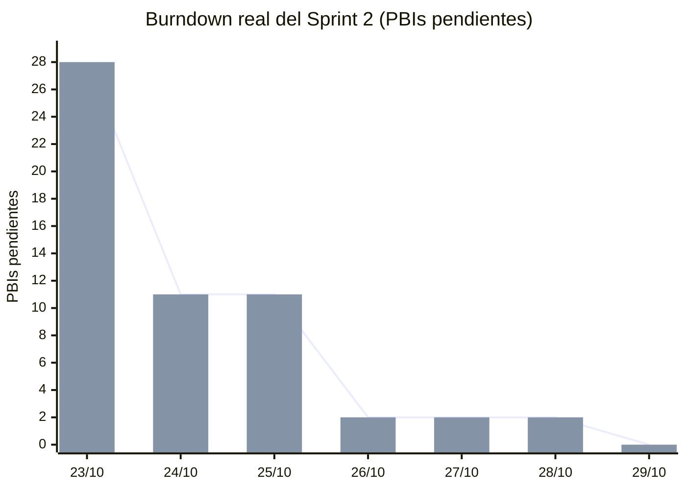

# Sprint 2

Del 23/10/2026 al 29/10/2026. Cerrado el Sprint 1, el profesor fijó que el **Sprint 2 es la lógica del juego**. El tablero está en [DoneTonic](https://app.donetonic.com): 29 PBIs (P20–P48) y 50 tareas (T33–T82), con una etiqueta por fase del juego. **Estado: hecho.**

## Objetivo

Construir sobre la base SaaS del Sprint 1 un juego *survivor* rojiblanco en pixel art, jugable en el navegador, con el progreso del club (plantilla, entrenamiento, fichas, logros) y el ranking guardados y validados en el servidor. El detalle del juego está en [juego.md](juego.md).

## Etiquetas

| Etiqueta | PBIs | Qué agrupa |
|---|---|---|
| Base del juego | P20–P28 | Interfaz rediseñada, motor survivor, pixel art, jugadores, armas, rivales, jefes, mapa y controles |
| Fase 2 · Club | P29–P32 | Progreso en el servidor, contratos, entrenamiento y ranking |
| Fase 3 · Ultras | P33–P34 | Combinaciones, ULTRAS, dificultad y modo pruebas |
| Fase 4 · Mundo | P35–P37 | Mundo procedural, ambientes por finales, mote y avatar |
| Fase 5 · Rarezas | P38–P41 | Rarezas por historia, habilidades niveladas, combinaciones a la vista y colisiones |
| Fase 6 · Logros y sonido | P42–P46 | Logros, pantalla de fin, música y grada, muñecos y jefes |
| Calidad | P47–P48 | Errores corregidos, documentación y gestión |

## Backlog y estado del Sprint 2

«Hecho» es el día en que se fusionó en `main` el último PR del PBI.

| PBI | Etiqueta | Título | Tareas | PRs | Hecho | Estado |
|---|---|---|---|---|---|---|
| P20 | Base del juego | Rediseño de la interfaz web y menú del juego | T33, T34 | #36, #45 | 24/10/2026 | Hecho |
| P21 | Base del juego | Motor de la partida survivor | T35, T36 | #36 | 23/10/2026 | Hecho |
| P22 | Base del juego | Gráficos pixel art y cámara 3/4 | T37, T38 | #44, #46 | 24/10/2026 | Hecho |
| P23 | Base del juego | Jugadores, entrenadores y Vestuario | T39–T41 | #44, #48 | 24/10/2026 | Hecho |
| P24 | Base del juego | Armas, habilidades y mejoras | T42, T43 | #36, #48 | 24/10/2026 | Hecho |
| P25 | Base del juego | Rivales con comportamiento propio | T44, T45 | #44, #45, #47 | 24/10/2026 | Hecho |
| P26 | Base del juego | Jefes con fases | T46, T47 | #45, #48 | 24/10/2026 | Hecho |
| P27 | Base del juego | Mapa con terreno y obstáculos | T48, T49 | #45, #47 | 24/10/2026 | Hecho |
| P28 | Base del juego | Controles, pantalla completa y ajustes | T50, T51 | #36, #47 | 24/10/2026 | Hecho |
| P29 | Fase 2 · Club | Progreso del juego guardado en el servidor | T52, T53 | #49 | 24/10/2026 | Hecho |
| P30 | Fase 2 · Club | Contratos: fichar jugadores | T54 | #49 | 24/10/2026 | Hecho |
| P31 | Fase 2 · Club | Entrenamiento de jugadores | T55 | #49, #50 | 24/10/2026 | Hecho |
| P32 | Fase 2 · Club | Ranking de la grada | T56 | #49 | 24/10/2026 | Hecho |
| P33 | Fase 3 · Ultras | Combinaciones y ULTRAS | T57, T58 | #50 | 24/10/2026 | Hecho |
| P34 | Fase 3 · Ultras | Dificultad equilibrada y modo pruebas | T59, T60 | #50 | 24/10/2026 | Hecho |
| P35 | Fase 4 · Mundo | Mundo procedural natural | T61 | #52 | 24/10/2026 | Hecho |
| P36 | Fase 4 · Mundo | Ambientes por finales | T62 | #52 | 24/10/2026 | Hecho |
| P37 | Fase 4 · Mundo | Mote y avatar | T63 | #52 | 24/10/2026 | Hecho |
| P38 | Fase 5 · Rarezas | Rarezas por historia rojiblanca y fichajes | T64, T65 | #53 | 26/10/2026 | Hecho |
| P39 | Fase 5 · Rarezas | Habilidades niveladas por minuto | T66 | #53 | 26/10/2026 | Hecho |
| P40 | Fase 5 · Rarezas | Combinaciones y ultras a la vista | T67 | #53 | 26/10/2026 | Hecho |
| P41 | Fase 5 · Rarezas | Colisiones exactas | T68 | #53 | 26/10/2026 | Hecho |
| P42 | Fase 6 · Logros y sonido | Logros con historia y equipaciones | T69, T70 | #54 | 26/10/2026 | Hecho |
| P43 | Fase 6 · Logros y sonido | Pantalla de fin con estadísticas | T71 | #54 | 26/10/2026 | Hecho |
| P44 | Fase 6 · Logros y sonido | Música chiptune y la grada | T72–T74 | #54 | 26/10/2026 | Hecho |
| P45 | Fase 6 · Logros y sonido | Muñecos con más detalle | T75 | #54 | 26/10/2026 | Hecho |
| P46 | Fase 6 · Logros y sonido | Jefes más duros | T76 | #54 | 26/10/2026 | Hecho |
| P47 | Calidad | Corrección de errores detectados | T77–T79 | #51, #55, #56 | 29/10/2026 | Hecho |
| P48 | Calidad | Documentación y gestión del Sprint 2 | T80–T82 | #55 | 29/10/2026 | Hecho |

## Historias de usuario y criterios de aceptación

Cada PBI del Sprint 2 tiene en DoneTonic su historia de usuario y sus criterios de aceptación. Son estos:

Ver las 29 historias de usuario con sus criterios

- **P20 · Rediseño de la interfaz web y menú del juego** (Base del juego). Como aficionado quiero una web con aspecto de juego, clara en el móvil y en el ordenador, para que entrar a jugar sea lo primero que vea al iniciar sesión.
  - Sistema de diseño propio (colores, espacios, tipografía Plus Jakarta Sans) en tokens CSS reutilizables.
  - Modo oscuro rojiblanco en toda la web y diseño responsive.
  - Con sesión iniciada el inicio es el menú del juego; la cabecera solo muestra Jugar y Mi cuenta (y Administración al admin).
  - Las pantallas de cuentas del Sprint 1 siguen funcionando igual (pruebas en verde).
- **P21 · Motor de la partida survivor** (Base del juego). Como jugador quiero una partida de supervivencia contra oleadas infinitas, en la que mis armas ataquen solas y yo solo tenga que moverme y elegir mejoras.
  - Simulación pura (sin DOM) con paso fijo de 1/60 s y azar con semilla: misma semilla, misma partida.
  - Oleadas cada 30 s, experiencia al eliminar rivales y elección de 1 de 3 mejoras al subir de nivel.
  - Dificultad que crece sin parar (vida, daño y velocidad de los rivales).
  - Pausa, fin de partida y vuelta al menú; la partida se pausa al cambiar de pestaña.
- **P22 · Gráficos pixel art y cámara 3/4** (Base del juego). Como jugador quiero un estilo visual propio y reconocible, con muñecos «chibi» del Atleti, para que el juego tenga personalidad sin usar imágenes oficiales.
  - Muñecos de 16×20 píxeles dibujados con código (sin imágenes), con caché de fotogramas.
  - Cámara 3/4 con inercia, inclinación al correr, destellos y aplastado al recibir golpes.
  - Se respeta prefers-reduced-motion (sin sacudidas ni partículas).
- **P23 · Jugadores, entrenadores y Vestuario** (Base del juego). Como jugador quiero elegir entre leyendas del Atleti y un entrenador, cada uno con su estilo, para que cada partida se juegue distinto.
  - Estadísticas por posición (portero, defensa, medio, delantero) retocadas por los rasgos de cada jugador.
  - Cada jugador solo puede aprender las habilidades que encajan con su forma de jugar.
  - Dos entrenadores (Simeone y Luis Aragonés) con bonificaciones y una ulti propia.
  - Vestuario con filtro por posición y ficha del jugador.
- **P24 · Armas, habilidades y mejoras** (Base del juego). Como jugador quiero muchas armas y habilidades que suban de nivel y se puedan combinar, para construir una estrategia distinta en cada partida.
  - Armas de disparo y cuerpo a cuerpo que atacan solas, con 5 niveles.
  - Pasivas (botas, imán, pasión…) y mejoras extra sin límite cuando todo está al máximo.
  - Los porteros no aprenden armas de disparo.
- **P25 · Rivales con comportamiento propio** (Base del juego). Como jugador quiero rivales variados que me obliguen a moverme, para que la partida no sea solo aguantar en un sitio.
  - 16 equipos con jugadores genéricos que se desbloquean por oleadas.
  - Unos embisten avisando con un «!» y otros disparan balones.
  - Los rivales rodean gradas y paredes para llegar al jugador.
- **P26 · Jefes con fases** (Base del juego). Como jugador quiero jefes famosos con ataques propios cada pocas oleadas, para tener retos claros dentro de la partida.
  - Un jefe cada 4 oleadas, al azar entre los disponibles y sin repetir hasta que salgan todos.
  - Tres fases por vida (66 % y 33 %): más ataques, menos espera y más velocidad.
  - Cada ataque fuerte se avisa en el suelo antes de golpear.
- **P27 · Mapa con terreno y obstáculos** (Base del juego). Como jugador quiero un campo con barro, lluvia, gradas y estructuras, para que moverse por el mapa sea parte del juego.
  - Barro que frena, lluvia que acelera los balones y gradas que no se atraviesan.
  - Mapa procedural con biomas y estructuras distinto en cada partida.
  - Premios por el campo señalados con flechas en el borde de la pantalla.
- **P28 · Controles, pantalla completa y ajustes** (Base del juego). Como jugador quiero jugar con teclado o con el dedo y ajustar el sonido y los gráficos, para jugar cómodo en cualquier dispositivo.
  - Teclado (WASD/flechas) y joystick táctil flotante en el móvil.
  - Pantalla completa (botón y tecla F) y menú de pausa con ajustes dentro de la partida.
  - Ajustes guardados en el navegador: volumen, efectos, números de daño, zoom y joystick.
- **P29 · Progreso del juego guardado en el servidor** (Fase 2 · Club). Como jugador quiero que mi club y mis partidas se guarden en mi cuenta, para no perder el progreso al cambiar de dispositivo.
  - Tablas juego_perfiles y juego_records (migración 003) ligadas al usuario.
  - API /api/juego protegida con sesión: perfil, empezar y terminar partida.
  - El servidor valida cada resultado con su propio reloj (anti-trampas) y rechaza resultados imposibles.
  - Concurrencia optimista: dos peticiones a la vez no se pisan.
- **P30 · Contratos: fichar jugadores** (Fase 2 · Club). Como jugador quiero ganar fichas de contrato venciendo jefes y canjearlas por jugadores nuevos, para ampliar mi plantilla.
  - Plantilla inicial de 4 jugadores comunes (uno por posición).
  - Una ficha por cada 3 jefes vencidos en la cuenta; el contrato nunca repite jugador.
  - La probabilidad depende de la rareza del jugador.
- **P31 · Entrenamiento de jugadores** (Fase 2 · Club). Como jugador quiero entrenar a mis jugadores con los puntos que ganan, para que mejoren partida a partida.
  - Puntos por jefes (1 cada 3 con ese jugador) y por bajas (cada vez más caros).
  - Cuatro estadísticas (Vida, Defensa, Disparo y Suerte) hasta 20 puntos.
  - Solo se gastan puntos libres; validado en el servidor.
- **P32 · Ranking de la grada** (Fase 2 · Club). Como jugador quiero compararme con el resto de aficionados, para tener un motivo para mejorar mi marca.
  - Una fila por usuario con su mejor partida (tiempo; en empate, nivel).
  - Nunca se muestra el correo de nadie.
  - Pestañas Mis partidas y La grada.
- **P33 · Combinaciones y ULTRAS** (Fase 3 · Ultras). Como jugador quiero que juntar ciertas habilidades desbloquee combinaciones y poderes definitivos, para premiar las estrategias pensadas.
  - 24 combinaciones con nombre propio y bonus.
  - 6 ULTRAS que se consiguen solas al completar combinaciones (Premio Puskás, Balón de Oro, Zamora…).
  - Efecto visual propio y daño en parte porcentual (reducido contra jefes).
- **P34 · Dificultad equilibrada y modo pruebas** (Fase 3 · Ultras). Como jugador quiero que el juego sea difícil pero justo, y como administrador quiero poder probarlo todo sin jugar horas.
  - Tramo final más duro desde el minuto 9 y rivales curtidos desde el 12.
  - Ayuda inicial que se apaga en 8 minutos para poder vencer al primer jefe.
  - Modo pruebas (solo admin): todos los jugadores y puntos sin tocar el ranking.
- **P35 · Mundo procedural natural** (Fase 4 · Mundo). Como jugador quiero un mundo distinto en cada partida, con barrios, estadios, parques y mesetas, para que explorar tenga gracia.
  - Ruidos suaves para distrito, altura y humedad: todo encaja sin cortes.
  - Estadios con gradas que miran al campo, plazas con tiendas, mesetas con escaleras.
  - Casi todo el mapa es alcanzable desde la salida (con pruebas).
- **P36 · Ambientes por finales** (Fase 4 · Mundo). Como jugador quiero que cada 5 minutos la partida cambie de escenario, para sentir que avanzo de final en final.
  - Pretemporada → Copa del Rey → Liga → Champions → Mundial.
  - Cambian la luz, el césped, la afición y los carteles; los rivales salen más fuertes.
  - En el Mundial todos llevan la camiseta de su selección.
- **P37 · Mote y avatar** (Fase 4 · Mundo). Como jugador quiero un mote y una cara propios, para que en el ranking y en la cabecera no salga mi correo.
  - Mote de 3 a 16 caracteres, único sin distinguir mayúsculas ni tildes (409 si está cogido).
  - Avatar con la cara de un jugador fichado o de un entrenador.
  - Migración 004 y PUT /api/juego/identidad.
- **P38 · Rarezas por historia rojiblanca y fichajes** (Fase 5 · Rarezas). Como aficionado quiero que la rareza de cada jugador refleje lo que fue en el Atleti, y que fichar se sienta especial.
  - 36 jugadores en cuatro rarezas (Común, Raro, Épico, Leyenda) según su historia en el club.
  - Más rareza = más habilidades aprendibles y menos probabilidad en un contrato.
  - Animación de la firma del contrato en pixel art.
- **P39 · Habilidades niveladas por minuto** (Fase 5 · Rarezas). Como jugador quiero que las habilidades más fuertes no rompan la partida al principio.
  - Niveles que no salen hasta cierto minuto (desdeMinuto) y recarga mínima (cdMin).
  - Regate, entrada rasante y contragolpe reequilibrados.
- **P40 · Combinaciones y ultras a la vista** (Fase 5 · Rarezas). Como jugador quiero ver qué combinaciones y ultras existen y qué me falta, para planificar la partida.
  - Pantalla Combinaciones con nombre, bonus, requisitos y ultra a la que cuentan.
  - Filtros Todas / Con tu jugador / Conseguidas.
- **P41 · Colisiones exactas** (Fase 5 · Rarezas). Como jugador quiero que lo que veo sea lo que choca, para que nadie se esconda detrás de un tejado.
  - Edificios, gradas y bancos chocan en todo su dibujo.
  - Los muñecos chocan por los pies (vista 3/4); la copa de los árboles se vuelve transparente.
- **P42 · Logros con historia y equipaciones** (Fase 6 · Logros y sonido). Como aficionado quiero logros con datos curiosos del Atleti que desbloqueen equipaciones, para tener objetivos a largo plazo.
  - 29 logros con un dato real que se descubre al conseguirlo.
  - El servidor solo apunta los logros que puede comprobar.
  - 10 equipaciones que se eligen en el Vestuario.
- **P43 · Pantalla de fin con estadísticas** (Fase 6 · Logros y sonido). Como jugador quiero ver al final de la partida qué ha funcionado, para mejorar en la siguiente.
  - Tiempo, ambiente, bajas, jefes, daño total, golpe máximo, críticos, daño recibido y vida recuperada.
  - Barras de daño por habilidad (armas, ultras, ulti y quemaduras).
  - Jefes vencidos con lo que costaron y logros nuevos.
- **P44 · Música chiptune y la grada** (Fase 6 · Logros y sonido). Como jugador quiero música y ambiente de estadio, para que la partida emocione.
  - Fanfarria propia por competición y canción de fondo que se anima con el tiempo y con los jefes.
  - La grada murmura y canta cuando te acercas a ella.
  - Volumen de música aparte del de efectos; todo sintetizado (sin ficheros).
- **P45 · Muñecos con más detalle** (Fase 6 · Logros y sonido). Como aficionado quiero reconocer a los jugadores y a los jefes en el campo.
  - Sombreado, orejas, nariz y peinados nuevos.
  - Rasgos propios: brazalete de capitán, cinta, pecas, barba, pendientes, tatuajes.
- **P46 · Jefes más duros** (Fase 6 · Logros y sonido). Como jugador quiero que los jefes sean un reto de verdad a partir del segundo.
  - Escolta de élites desde el segundo jefe y refuerzos al cambiar de fase.
  - Furia si tardas en ganarles.
  - Una jugada estrella por jefe en la fase 3; el primero sigue siendo asequible.
- **P47 · Corrección de errores detectados** (Calidad). Como usuario quiero que los errores que encuentren los probadores se arreglen con pruebas que eviten que vuelvan.
  - Cada error se reproduce con una prueba antes de arreglarlo.
  - Los arreglos pasan el CI y se despliegan.
- **P48 · Documentación y gestión del Sprint 2** (Calidad). Como responsable del proyecto quiero que todo el Sprint 2 se pueda revisar desde el repositorio.
  - README con capturas del juego y de DoneTonic.
  - Documentación técnica para la memoria con diagramas.
  - Backlog, tablero y gráficas del Sprint 2 en DoneTonic.

## Trazabilidad del Sprint 2: tarea → pull request

Las tareas de cada PBI indican en su descripción de DoneTonic el PR donde está el trabajo.

| PBI | Tarea | Descripción | Pull request | Estado |
|---|---|---|---|---|
| P20 | T33 | Sistema de diseño: tokens, tipografía y modo oscuro rojiblanco | [#36](https://github.com/VelaElDios/la-grada-colchonera-saas/pull/36) | Hecho |
|  | T34 | Menú del juego como inicio con sesión (hub con el jugador paseando) | [#36](https://github.com/VelaElDios/la-grada-colchonera-saas/pull/36) · [#45](https://github.com/VelaElDios/la-grada-colchonera-saas/pull/45) | Hecho |
| P21 | T35 | Simulación de paso fijo con semilla (mundo.js) | [#36](https://github.com/VelaElDios/la-grada-colchonera-saas/pull/36) | Hecho |
|  | T36 | Oleadas, experiencia y mejoras al subir de nivel | [#36](https://github.com/VelaElDios/la-grada-colchonera-saas/pull/36) | Hecho |
| P22 | T37 | Muñecos chibi generados por código (sprites.js) | [#44](https://github.com/VelaElDios/la-grada-colchonera-saas/pull/44) | Hecho |
|  | T38 | Cámara 3/4, inercia y sensación de movimiento y golpes | [#46](https://github.com/VelaElDios/la-grada-colchonera-saas/pull/46) | Hecho |
| P23 | T39 | Jugadores con estadísticas por posición y habilidades propias | [#44](https://github.com/VelaElDios/la-grada-colchonera-saas/pull/44) · [#48](https://github.com/VelaElDios/la-grada-colchonera-saas/pull/48) | Hecho |
|  | T40 | Entrenadores con ulti y pantalla Dirección | [#44](https://github.com/VelaElDios/la-grada-colchonera-saas/pull/44) | Hecho |
|  | T41 | Vestuario renovado con filtros y ficha | [#48](https://github.com/VelaElDios/la-grada-colchonera-saas/pull/48) | Hecho |
| P24 | T42 | Armas con 5 niveles: disparo, cuerpo a cuerpo y movilidad | [#36](https://github.com/VelaElDios/la-grada-colchonera-saas/pull/36) · [#48](https://github.com/VelaElDios/la-grada-colchonera-saas/pull/48) | Hecho |
|  | T43 | Pasivas y mejoras extra | [#36](https://github.com/VelaElDios/la-grada-colchonera-saas/pull/36) | Hecho |
| P25 | T44 | 16 equipos rivales que se desbloquean por oleadas | [#44](https://github.com/VelaElDios/la-grada-colchonera-saas/pull/44) | Hecho |
|  | T45 | Rivales que embisten, disparan y rodean obstáculos | [#45](https://github.com/VelaElDios/la-grada-colchonera-saas/pull/45) · [#47](https://github.com/VelaElDios/la-grada-colchonera-saas/pull/47) | Hecho |
| P26 | T46 | Jefes con tres fases y avisos de ataque | [#45](https://github.com/VelaElDios/la-grada-colchonera-saas/pull/45) | Hecho |
|  | T47 | Seis jefes nuevos con habilidades propias | [#48](https://github.com/VelaElDios/la-grada-colchonera-saas/pull/48) | Hecho |
| P27 | T48 | Barro, lluvia, gradas y premios | [#45](https://github.com/VelaElDios/la-grada-colchonera-saas/pull/45) | Hecho |
|  | T49 | Mapa procedural con biomas y estructuras | [#47](https://github.com/VelaElDios/la-grada-colchonera-saas/pull/47) | Hecho |
| P28 | T50 | Entrada por teclado y joystick táctil | [#36](https://github.com/VelaElDios/la-grada-colchonera-saas/pull/36) | Hecho |
|  | T51 | Pantalla completa, pausa y ajustes en partida | [#47](https://github.com/VelaElDios/la-grada-colchonera-saas/pull/47) | Hecho |
| P29 | T52 | Migración 003 y repositorios del juego (memoria y PostgreSQL) | [#49](https://github.com/VelaElDios/la-grada-colchonera-saas/pull/49) | Hecho |
|  | T53 | API del juego con validación anti-trampas | [#49](https://github.com/VelaElDios/la-grada-colchonera-saas/pull/49) | Hecho |
| P30 | T54 | Fichas por jefes y sorteo de contratos por rareza | [#49](https://github.com/VelaElDios/la-grada-colchonera-saas/pull/49) | Hecho |
| P31 | T55 | Puntos y estadísticas de entrenamiento | [#49](https://github.com/VelaElDios/la-grada-colchonera-saas/pull/49) · [#50](https://github.com/VelaElDios/la-grada-colchonera-saas/pull/50) | Hecho |
| P32 | T56 | Ranking multijugador con la mejor partida de cada usuario | [#49](https://github.com/VelaElDios/la-grada-colchonera-saas/pull/49) | Hecho |
| P33 | T57 | Combinaciones con nombre y bonus | [#50](https://github.com/VelaElDios/la-grada-colchonera-saas/pull/50) | Hecho |
|  | T58 | Seis ULTRAS con efectos visuales | [#50](https://github.com/VelaElDios/la-grada-colchonera-saas/pull/50) | Hecho |
| P34 | T59 | Curvas de dificultad calibradas con un bot | [#50](https://github.com/VelaElDios/la-grada-colchonera-saas/pull/50) | Hecho |
|  | T60 | Modo pruebas para administradores | [#50](https://github.com/VelaElDios/la-grada-colchonera-saas/pull/50) | Hecho |
| P35 | T61 | Generación del terreno por ruidos (terreno.js) | [#52](https://github.com/VelaElDios/la-grada-colchonera-saas/pull/52) | Hecho |
| P36 | T62 | Cinco ambientes con cambio de luz, afición y fuerza | [#52](https://github.com/VelaElDios/la-grada-colchonera-saas/pull/52) | Hecho |
| P37 | T63 | Migración 004, API de identidad y pantalla Tu ficha | [#52](https://github.com/VelaElDios/la-grada-colchonera-saas/pull/52) | Hecho |
| P38 | T64 | Rarezas por historia y 36 jugadores | [#53](https://github.com/VelaElDios/la-grada-colchonera-saas/pull/53) | Hecho |
|  | T65 | Animación de la firma del contrato | [#53](https://github.com/VelaElDios/la-grada-colchonera-saas/pull/53) | Hecho |
| P39 | T66 | Niveles bloqueados por minuto y recarga mínima | [#53](https://github.com/VelaElDios/la-grada-colchonera-saas/pull/53) | Hecho |
| P40 | T67 | Pantalla de combinaciones y ultras con filtros | [#53](https://github.com/VelaElDios/la-grada-colchonera-saas/pull/53) | Hecho |
| P41 | T68 | Hitbox por los pies y obstáculos macizos | [#53](https://github.com/VelaElDios/la-grada-colchonera-saas/pull/53) | Hecho |
| P42 | T69 | Logros validados en el servidor (logros.js) | [#54](https://github.com/VelaElDios/la-grada-colchonera-saas/pull/54) | Hecho |
|  | T70 | Pantalla Logros y equipaciones en el Vestuario | [#54](https://github.com/VelaElDios/la-grada-colchonera-saas/pull/54) | Hecho |
| P43 | T71 | Atribución del daño por fuente y pantalla de fin (fin-ui.js) | [#54](https://github.com/VelaElDios/la-grada-colchonera-saas/pull/54) | Hecho |
| P44 | T72 | Secuenciador chiptune y fanfarrias (musica.js) | [#54](https://github.com/VelaElDios/la-grada-colchonera-saas/pull/54) | Hecho |
|  | T73 | La grada: murmullo y cánticos según la cercanía | [#54](https://github.com/VelaElDios/la-grada-colchonera-saas/pull/54) | Hecho |
|  | T74 | Efectos de sonido nuevos y ajuste de música | [#54](https://github.com/VelaElDios/la-grada-colchonera-saas/pull/54) | Hecho |
| P45 | T75 | Rasgos y sombreado en sprites.js | [#54](https://github.com/VelaElDios/la-grada-colchonera-saas/pull/54) | Hecho |
| P46 | T76 | Escolta, furia y jugada estrella | [#54](https://github.com/VelaElDios/la-grada-colchonera-saas/pull/54) | Hecho |
| P47 | T77 | El juego no cargaba (variable usada antes de existir) | [#51](https://github.com/VelaElDios/la-grada-colchonera-saas/pull/51) | Hecho |
|  | T78 | El primer clic en «Reenviar el correo» se perdía tras un error | [#55](https://github.com/VelaElDios/la-grada-colchonera-saas/pull/55) | Hecho |
|  | T79 | No se podía volver tras eliminar la cuenta (Google) | [#56](https://github.com/VelaElDios/la-grada-colchonera-saas/pull/56) | Hecho |
| P48 | T80 | README del Sprint 2 con capturas del juego y de DoneTonic | `docs/sprint-2` (este PR) | Hecho |
|  | T81 | Documentación técnica para la memoria | [#55](https://github.com/VelaElDios/la-grada-colchonera-saas/pull/55) | Hecho |
|  | T82 | Backlog y seguimiento del Sprint 2 en DoneTonic | — (DoneTonic) | Hecho |

| PR | Fase | Fecha de fusión |
|---|---|---|
| [#36](https://github.com/VelaElDios/la-grada-colchonera-saas/pull/36) | Rediseño de la interfaz y base del survivor (Fase 1) | 23/10/2026 |
| [#44](https://github.com/VelaElDios/la-grada-colchonera-saas/pull/44) | Personajes en pixel art, entrenadores y rivales | 24/10/2026 |
| [#45](https://github.com/VelaElDios/la-grada-colchonera-saas/pull/45) | Movilidad, barro, lluvia, gradas, rivales que disparan, jefes con fases y menú | 24/10/2026 |
| [#46](https://github.com/VelaElDios/la-grada-colchonera-saas/pull/46) | Cámara 3/4 y sensación de movimiento | 24/10/2026 |
| [#47](https://github.com/VelaElDios/la-grada-colchonera-saas/pull/47) | Mapa procedural, pantalla completa y menú en partida | 24/10/2026 |
| [#48](https://github.com/VelaElDios/la-grada-colchonera-saas/pull/48) | 19 jugadores, 12 armas, combinaciones, 6 jefes y Vestuario | 24/10/2026 |
| [#49](https://github.com/VelaElDios/la-grada-colchonera-saas/pull/49) | Fase 2: club en el servidor | 24/10/2026 |
| [#50](https://github.com/VelaElDios/la-grada-colchonera-saas/pull/50) | Fase 3: ultras y dificultad | 24/10/2026 |
| [#51](https://github.com/VelaElDios/la-grada-colchonera-saas/pull/51) | Arreglo: el juego no cargaba | 24/10/2026 |
| [#52](https://github.com/VelaElDios/la-grada-colchonera-saas/pull/52) | Fase 4: mundo, ambientes, mote y avatar | 24/10/2026 |
| [#53](https://github.com/VelaElDios/la-grada-colchonera-saas/pull/53) | Fase 5: rarezas, habilidades niveladas, firma y colisiones | 26/10/2026 |
| [#54](https://github.com/VelaElDios/la-grada-colchonera-saas/pull/54) | Fase 6: logros, fin de partida, música, muñecos y jefes | 26/10/2026 |
| [#55](https://github.com/VelaElDios/la-grada-colchonera-saas/pull/55) | Documentación (README y documentación técnica) y arreglo del reenvío | 27/10/2026 |
| [#56](https://github.com/VelaElDios/la-grada-colchonera-saas/pull/56) | Arreglo: volver con la misma cuenta de Google tras darse de baja | 29/10/2026 |

## Evolución del Sprint 2

PBIs pendientes según la fecha en que se fusionó el último PR de cada uno:

| Día | PBIs hechos ese día | PBIs hechos (acumulado) | PBIs pendientes |
|---|---:|---:|---:|
| Inicio (23/10/2026) | 0 | 0 | 29 |
| 23/10 (PR #36) | 1 | 1 | 28 |
| 24/10 (PRs #44–#52) | 17 | 18 | 11 |
| 25/10 | 0 | 18 | 11 |
| 26/10 (PRs #53 y #54) | 9 | 27 | 2 |
| 27/10 (PR #55) | 0 | 27 | 2 |
| 28/10 | 0 | 27 | 2 |
| 29/10 (PR #56 y documentación) | 2 | 29 | 0 |

| Métrica | Sprint 1 | Sprint 2 |
|---|---:|---:|
| Duración | 4 semanas | 1 semana |
| PBIs comprometidos / hechos | 19 / 19 | 29 / 29 |
| Tareas | 32 | 50 |
| Pull requests fusionados | #1–#34 y #37–#41 (uno por tarea y por cierre de hito) | #36 y #44–#56 (uno por fase y por arreglo) |
| Pruebas automáticas en `main` al cerrar el sprint | — | 276 (cuentas, API, base de datos y juego) |

## Capturas de DoneTonic

**Tablero del Sprint 2** al 100 %: los 29 PBIs (P20–P48) con su etiqueta de fase.

**Tareas de un PBI.** P48 desplegado: sus tres tareas (T80–T82) en la columna *HECHO*, que suma las 50 tareas del sprint.

**Detalle de un PBI.** P44 con su historia de usuario, sus criterios de aceptación y sus tareas (T72–T74).

**Sprint Burndown y Sprint Burnup del Sprint 2.** Los 29 PBIs completados.

> **Sobre las gráficas del Sprint 2.** El juego se programó del 23 al 26/10, antes de que el profesor fijara que el Sprint 2 sería la lógica del juego. El backlog del Sprint 2 se registró en DoneTonic al cerrar el sprint (29/10), así que DoneTonic marca todos los PBIs como hechos ese día y sus gráficas salen como una recta. La evolución real, sacada de las fechas de los PRs, está en la [tabla de evolución del Sprint 2](#evolución-del-sprint-2).

**Backlog Burndown y Backlog Burnup.** El producto completo a lo largo de los dos sprints (48 PBIs).

## Verificación

- Suite automática: las fases del juego añadieron sus propias pruebas (`juego-*.test.js`, `api.juego.test.js`, `juegoRepository.test.js`, `game.test.js`); el detalle por fichero está en [procesos.md](procesos.md#pruebas). Todas pasan en el CI con PostgreSQL 17.
- Cada fase se probó a mano en el navegador (ordenador y móvil) antes de fusionarse, y se comprobó desplegada en Cloud Run.
- Las reglas del club y los logros se validan en el servidor: un resultado inventado se rechaza (pruebas en `api.juego.test.js`).

## Trabajo posterior al cierre del sprint

Después del 29/10/2026 el juego siguió mejorando sobre `main`, con el mismo flujo (rama, PR, CI y despliegue). Estos cambios no están registrados como PBIs en DoneTonic; están en [log.md](log.md).

| Fecha | PR | Qué |
|---|---|---|
| 29/10/2026 | [#56](https://github.com/VelaElDios/la-grada-colchonera-saas/pull/56) | Tras eliminar la cuenta se puede volver con el mismo email o con Google (lo encontró un compañero probando la aplicación) |
| 02/11/2026 | [#58](https://github.com/VelaElDios/la-grada-colchonera-saas/pull/58) | Fase 7: muñecos chibi, mapa nuevo, menú rediseñado, pausa con árbol de habilidades, 5 armas, 2 pasivas y 5 combinaciones nuevas |
| 03/11/2026 | [#59](https://github.com/VelaElDios/la-grada-colchonera-saas/pull/59) | Guardado de partidas largas, experiencia que dejaba de salir, hitboxes y rendimiento |

## Retrospectiva

### Hechos

- Los 29 PBIs están hechos e integrados en `main` con un PR por fase (#36 y #44–#54) y los arreglos #51, #55 y #56.
- 322 pruebas automáticas en verde tras el trabajo posterior al cierre.
- No hay etiqueta `sprint-2` en el repositorio.

### Qué funcionó

- Mantener la simulación del juego pura y determinista: se prueba en Node sin navegador, igual que el backend.
- Compartir las reglas (`club.js`, `config.js`, `logros.js`) entre cliente y servidor: una sola fuente de verdad y validación anti-trampas.
- Revisar cada fase con capturas en el navegador: así aparecieron fallos visuales y de interacción que las pruebas no veían.

### Problemas y cómo se resolvieron

| Problema | Causa | Solución |
|---|---|---|
| El juego dejó de cargar tras un cambio | Una variable del módulo usada en la plantilla HTML antes de existir | Arreglo inmediato y una prueba que importa todos los módulos del juego |
| Los jugadores podían esconderse detrás de los tejados | La colisión no coincidía con el dibujo en la vista 3/4 | Colisión por los pies y obstáculos que chocan en todo su dibujo |
| Tirones al pintar el suelo | Se pintaban muchas texturas por píxel en el mismo fotograma | Una textura por celda y ambiente, como mucho una por fotograma y por adelantado |
| Simulación lenta con muchos rivales | Búsqueda de obstáculos con claves de texto y demasiadas celdas | Búsqueda por radio con claves numéricas: unas 4,5 veces más rápida |
| El regate hacía al jugador intocable demasiado pronto | Subía de nivel sin límite | Niveles que no salen hasta cierto minuto y recarga mínima |
| Equilibrio difícil de ajustar a mano | Muchas variables | Todo el equilibrio en `config.js` y calibración con un bot que juega partidas simuladas |
| Quien eliminaba su cuenta (sobre todo de Google) no podía volver a entrar nunca con ese email (lo encontró un amigo probando la app, 29/10/2026) | Por la baja lógica la fila seguía en `users` con su email, que era `UNIQUE`; además, por diseño, una cuenta eliminada no podía entrar «ni con Google» | Migración 005: el email solo es único entre las cuentas no eliminadas (índice parcial); `findByEmail` ignora las eliminadas, así que registrarse o entrar con Google crea una cuenta nueva; al eliminar se suelta el mote y la cuenta sale del ranking. Pruebas nuevas del caso completo |
| Al pulsar «Reenviar el correo» después de un error de inicio de sesión, el primer clic se perdía | Al salir del campo de contraseña vacío aparecía su error, la página se movía y el clic caía fuera del botón | Un campo vacío que no se ha tocado ya no da error al salir de él; tras un fallo del servidor la contraseña se vacía sin marcar error (encontrado al hacer las capturas, 27/10/2026) |
| Las partidas largas no se guardaban ni salían en el ranking | El servidor rechazaba más de 20 rivales eliminados por segundo, y pasado el minuto 20 salen hasta 50 | Tope calculado con el ritmo real de aparición de rivales (`bajasPosibles`) |
| A veces dejaba de salir experiencia | Con 450 gemas en el campo, la experiencia nueva se sumaba a una gema al azar, casi siempre lejos | Se trae la gema más lejana a donde cae el rival |
| Obstáculos dibujados con el mapa de otra partida | La caché de dibujos de obstáculos no incluía la semilla del mapa | La semilla forma parte de la clave de la caché |

### Qué cambiaría

- Registrar el backlog en DoneTonic antes de programar, para que las gráficas del sprint reflejen la evolución real ([D-19](decisiones.md)).
- Dividir el trabajo del juego en PRs más pequeños, uno por tarea como en el Sprint 1.
- Crear la etiqueta `sprint-2` al cerrar el sprint.

## Métricas del proyecto

| Métrica | Valor |
|---|---|
| PBIs / tareas del Sprint 1 | 19 / 32 |
| PBIs / tareas del Sprint 2 | 29 / 50 |
| Pull requests | Más de 50 (uno por tarea, uno por cierre de hito y uno por fase del juego) |
| Releases | `hito-1`, `hito-2`, `hito-3`, `hito-4`, `sprint-1` |
| Pruebas automáticas | 322 (+ el recorrido con PostgreSQL real en el CI) |
| Endpoints de la API | 23 |
| Migraciones | 5 |
| Líneas de código del backend (`src/`, con SQL) | ~2.300 |
| Líneas de la interfaz web (`ui.js`, `api.js`, `ui/`) | ~1.150 |
| Líneas de CSS | ~950 |
| Líneas del juego (`public/js/game/`, 35 módulos) | ~14.800 |
| Líneas de pruebas | ~5.050 |
| Dependencias de producción | 6 (`express`, `express-session`, `connect-pg-simple`, `pg`, `bcryptjs`, `nodemailer`) |
| Contenido del juego | 36 jugadores, 2 entrenadores, 29 armas, 16 pasivas, 29 combinaciones, 6 ultras, 16 equipos, 10 jefes, 5 ambientes, 26 selecciones, 29 logros, 10 equipaciones |

## Conclusiones

- Los **cuatro hitos del Sprint 1 están completos**, desplegados y comprobados en producción, con trazabilidad completa desde el backlog hasta la release. El **Sprint 2** (la lógica del juego) también está cerrado: 29 PBIs hechos.
- La **arquitectura en capas con inyección de dependencias** permitió cambiar de memoria a PostgreSQL, añadir correo y Google o montar un juego entero encima sin tocar la lógica existente.
- Probar primero los **casos de error** y tener el CI como requisito para fusionar evitó regresiones durante todo el desarrollo.
- Pasar de red social a **juego** fue una buena decisión: reutiliza toda la base del sprint y obliga a resolver problemas técnicos interesantes (determinismo, rendimiento, validación en el servidor, generación procedural, audio sintetizado).
- Lecciones: dividir pronto en tareas pequeñas, automatizar el despliegue desde el primer día, documentar las decisiones mientras se toman y comprobar visualmente cada cambio de interfaz (así apareció, por ejemplo, el clic perdido de la sección 13).

## Trabajo futuro

- **Multijugador:** lista de amigos y partidas en grupo (*party*) de hasta 4 jugadores, con WebSockets y un servidor autoritativo.
- Más contenido: jugadores, jefes, equipaciones y logros; mejorar los sprites de los jugadores menos conocidos.
- Ranking por temporadas y por ambiente.
- Recuperación de contraseña por correo y limitación de intentos de inicio de sesión (*rate limiting*).
- Pruebas de extremo a extremo automatizadas en el CI (Playwright) y medición de cobertura.
- Aplicación instalable (PWA) para jugar desde el móvil como una app.
